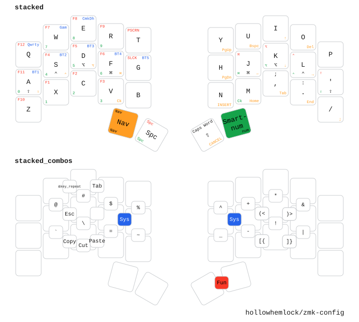

## ZMK Keyboard Config



### Setup

```bash
pipx install keymap-drawer  # Install keymap visualization tool
just setup-hooks            # Enable automatic keymap formatting on commit
```

### Usage

```bash
just build cradio    # Build firmware
just check           # Check for duplicate combos + layer priority
just fmt             # Format keymap files
just draw            # Generate keymap diagrams
just release cradio  # Build + draw + copy artifacts
just list            # List all build targets
```

### References

- [urob/zmk-config](https://github.com/urob/zmk-config)
- [urob/zmk-helpers](https://github.com/urob/zmk-helpers)
- [caksoylar/keymap-drawer](https://github.com/caksoylar/keymap-drawer)

### Merged diagram themes

With the installed `keymap-drawer` (`stack-layers`), Python 3 + PyYAML, and
`yq` available (provided by the Nix development shell):

```bash
just draw-merged              # Generate the default theme and merged.svg
just draw-merged-all          # Generate all seven merged_<theme>.svg files
just _draw-merged-theme print # Generate one theme from the existing base.yaml
```

Set `default` in `draw/inputs/themes.yaml` to select the theme copied to
`merged.svg` by `just draw-merged`; it remains `light`. Available themes are
`light`, `dark`, `primary`, `vivid`, `print`, `cool`, and `warm`. The print theme
uses darker corner colors on white with 9px, weight-500 corner text. Check a
physical print at your intended paper size before relying on its readability.

The theme helper appends CSS to a temporary drawing config and adds an explicit
SVG background. Each palette controls text, background/key fills, combo fills,
and the four corner/layer-key colors. Layer-key labels use whichever of black
or white has higher contrast. Optional `typography.corner_size` and
`typography.corner_weight` default to `8px` and `400`; optional `colors.border`
overrides outlines. Glyph dimensions and key/combo geometry come from the base
config. Theme settings do not affect base or gaming diagrams.
